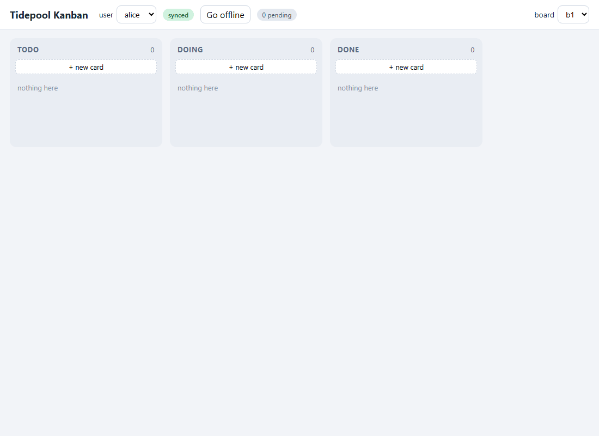

# Tidepool

Tidepool is a local-first sync server written in Go. Clients keep their own
copy of the data and can edit it offline. When they reconnect, their changes
merge with everyone else's automatically, using CRDTs (conflict-free
replicated data types). Any node in a cluster accepts writes; nodes catch each
other up by streaming their operation logs, with no leader election and no
consensus protocol.



The repository contains the server, Go and TypeScript client SDKs, a
collaborative kanban demo, a load generator and the benchmark results. It is
about 14k lines of Go, half of it tests.

## What it does

- **Five CRDT field types:** last-writer-wins registers, counters, add-wins
  sets, RGA lists and Unicode text. Every operation has an `(actor, seq)` ID, so
  deduplication and "what is this replica missing?" are version-vector checks.
- **Offline-first clients in Go and TypeScript.** Each client keeps confirmed
  server state separately from its pending local edits, shows the edits
  immediately, and replays them after reconnecting. The TypeScript SDK is tested
  against 50 test vectors generated by the Go implementation; the resulting
  snapshots must match byte for byte.
- **Durable group commit.** A single committer goroutine owns all document
  state and writes up to 256 queued requests in one Pebble batch with one fsync.
  Acknowledgments are sent only after the commit returns.
- **Authorization rules in CEL** over JWT claims and document values. A
  rejected edit is stored as a noop instead of being dropped, so per-actor
  sequence numbers stay contiguous and every replica agrees that the edit did
  nothing. The author's client rolls back its optimistic change.
- **Partial replication.** A client subscribes to a collection plus a CEL
  filter. When a document starts matching, the client receives a snapshot;
  while it matches, the client receives operations; when it stops matching,
  the client receives the final operation and then an eviction.
- **Multi-master replication.** Nodes pull each other's feeds and keep durable
  per-peer cursors. Duplicates are ignored, and order doesn't matter because the
  data types are CRDTs.
- **Operations tooling:** Prometheus metrics, an admin listener with document
  inspection and pprof (token-protected), the `tpctl` CLI, and the `tpload` load
  generator.

## How it was tested

Correctness relies mostly on randomized tests that can be reproduced from a seed
(`TIDEPOOL_SEED`, `TIDEPOOL_ITER`):

- **Convergence fuzzing:** four in-memory replicas make random edits to every
  field type and sync with each other in random order. The test asserts that
  their values, version vectors and snapshot round trips are identical.
- **Crash safety:** Pebble's crashable in-memory filesystem drops unsynced
  writes. The test checks that everything acknowledged survives and that the
  store reopens cleanly.
- **Chaos test:** three Pebble-backed nodes and six clients, with peer and
  client links cut and restored at random and clients moved between nodes. After
  healing, every node and every client must hold identical documents.
- **Cross-language conformance and end-to-end tests:** a TypeScript client and
  a Go client edit the same documents through a real server binary.

The chaos test found three real convergence bugs, all now fixed:

1. Clients persisted only their local edits, not the confirmed state from
   server echoes. After a restart, a client could reuse an already-committed
   operation ID for different content. No CRDT can reconcile that.
2. Moving a client between nodes raced the shutdown of its previous connection
   over the shared local store.
3. A lagging peer node evicted documents it hadn't replicated yet, which made
   clients drop real data.

A later 2,000-step convergence run also caught a bug where an RGA position
index depended on delivery history. A snapshot round trip then produced
different derived state. See [verification](docs/VERIFICATION.md) for the
final runs: 20 consecutive passes of the integration suite, 5 chaos-test passes,
and the race detector on Linux.

## Measured results

Single short runs on a Ryzen 7 7445HS laptop (Windows 11, local NVMe SSD). The
server and load generator ran on the same machine over loopback:

| Workload | Result |
|---|---|
| Durable commits, 1 request per fsync | 821 ops/s |
| Durable commits, 256 requests per fsync | 32,210 ops/s (~39× from group commit) |
| 64 clients, 100 documents, 1,000 ops/s offered | 999 ops/s completed, 0 errors |
| Fan-out latency for that run (630,000 deliveries) | p50 3.7 ms · p95 12.2 ms · p99 29.3 ms |
| RGA append at 100k items, before / after position index | 272 µs → ~1.5 µs per op |

These runs were rate-limited, so they show the server handling the offered
load, not its saturation point. Random mid-sequence RGA inserts are still linear
and got no faster from the index. [RESULTS.md](bench/RESULTS.md) has the
commands, raw output, environment and caveats.

## Design notes

- [Architecture](docs/ARCHITECTURE.md): request lifecycles for push,
  subscribe and peer replication
- [CRDT semantics](docs/CRDTS.md): apply rules and why RGA ordering converges
- [Wire protocol](docs/PROTOCOL.md): frames, ack statuses, sequence diagrams
- Decision records: [op-based CRDTs](docs/adr/0001-op-based-crdts.md),
  [subscribe inside the committer](docs/adr/0002-subscribe-in-committer.md),
  [multi-master without consensus](docs/adr/0003-multi-master.md),
  [noop rejection](docs/adr/0004-noop-rejection.md),
  [Pebble](docs/adr/0005-pebble.md),
  [shape scans](docs/adr/0006-shape-scan.md)

## Limitations

- No transactions across documents or fields. Each operation is merged
  independently.
- Write rules are evaluated against the origin node's local state, which may be
  stale. Two nodes can accept edits that a single global check would reject.
- Documents can't be deleted, and tombstones and logs are never compacted.
- Subscribing scans the whole collection; no secondary indexes yet.
- The TypeScript SDK uses JavaScript numbers, so counters and sequence numbers
  must stay within the safe-integer range.

## Quickstart: three nodes and the kanban demo

Requirements: Docker Compose, Node.js 22.12+ and npm. Go 1.26.3 is needed for
local-server runs, tests and the recording script. Run these commands from the
repository root.

Start the cluster with the **development-only** kanban overlay:

```powershell
docker compose -p tidepool-demo -f deploy/docker-compose.yml -f deploy/docker-compose.demo.yml up --build
```

In another terminal, build the local SDK and start the demo against node 1:

```powershell
npm --prefix sdk/ts ci
npm --prefix sdk/ts run build
npm --prefix examples/kanban ci
$env:VITE_SERVER_URL = 'ws://127.0.0.1:7200/v1/sync'
npm --prefix examples/kanban run dev -- --host 127.0.0.1 --port 5173 --strictPort
```

Open `http://127.0.0.1:5173`. To compare nodes, start a second Vite instance
against node 3 and open it in a second window:

```powershell
$env:VITE_SERVER_URL = 'ws://127.0.0.1:7202/v1/sync'
npm --prefix examples/kanban run dev -- --host 127.0.0.1 --port 5174 --strictPort
```

Each browser install gets its own actor ID, even if both windows select Alice.
Allow a few seconds for edits to cross nodes: peer catch-up flushes short
batches after two seconds of idle time.

The overlay enables `/dev/token?uid=` and permissive shared-editing rules for the
demo. Base configs keep dev mode off and use the ownership and board-claim
rules in `deploy/rules.yaml`. All sample ports bind to loopback. Replace the
example secrets and write your own rules before deploying anywhere else. To stop
the demo and keep its volumes:

```powershell
docker compose -p tidepool-demo -f deploy/docker-compose.yml -f deploy/docker-compose.demo.yml down
```

### Try it: offline convergence

1. On board **b1**, click **+ new card**. Edit its title (Enter or blur to
   save), description, labels (Enter) and checklist. Wait for the card to appear
   in the second window.
2. In the first window, click **Go offline**. Change the description and vote.
   The edits show up immediately and the pending counter goes up.
3. In the second window, still online, vote and add a different label.
4. Click **Go online** in the first window. Once pending reaches zero and the
   peers have caught up, both windows show the merged description, labels and
   votes.
5. Change the card's **Column** to move it to doing or done. Change its **Board**
   to **b2**, and it leaves b1 in both windows. Select b2 in each header to get
   the card back through the new subscription. **Archive card** moves it off both
   boards.
6. Switch users to try different identities. Pending edits survive switching
   away and back within the same window.

The demo keeps client state in memory. Keep the window open while offline,
because reloading loses unconfirmed edits. Confirmed documents persist in the
node volumes. To run a single local node instead of Docker:

```powershell
go run ./cmd/tidepoold --config examples/kanban/dev.yaml
```

Then set `VITE_SERVER_URL` to `ws://127.0.0.1:7100/v1/sync` before starting
Vite. That config stores confirmed documents in `data/demo`.

To replay the browser walkthrough and regenerate the GIF, install FFmpeg on
PATH and run this from `examples/kanban`:

```powershell
npx playwright install chromium
npm run demo:record
```

The recorder starts an isolated real server and two browser sessions, checks
offline convergence, user switching and board moves, and records screenshots.
For Go SDK usage, see the [integration tests](test/integration).

## Development

```powershell
gofmt -l .      # must print nothing
go vet ./...
go build ./...
go test ./...
npm --prefix sdk/ts test
npm --prefix sdk/ts run typecheck
```

CI also runs `go test -race ./...` on Linux. The chaos suite is skipped with
`-short`. Randomized tests log their seed so a failure can be replayed.

## Future Improvements can include

- Document deletion and tombstone/log garbage collection based on replica
  progress, without dropping dependencies that offline peers still reference.
- A binary wire encoding to cut per-operation overhead.
- Secondary indexes for common shape filters.
- Per-tenant workspaces with separate identity, resource and policy limits.
- End-to-end encryption, including how filters and authorization would work
  when servers can't read document fields.
