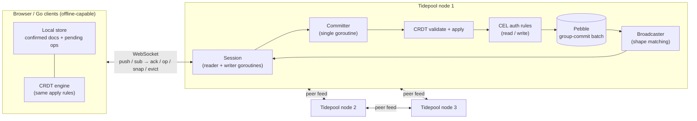
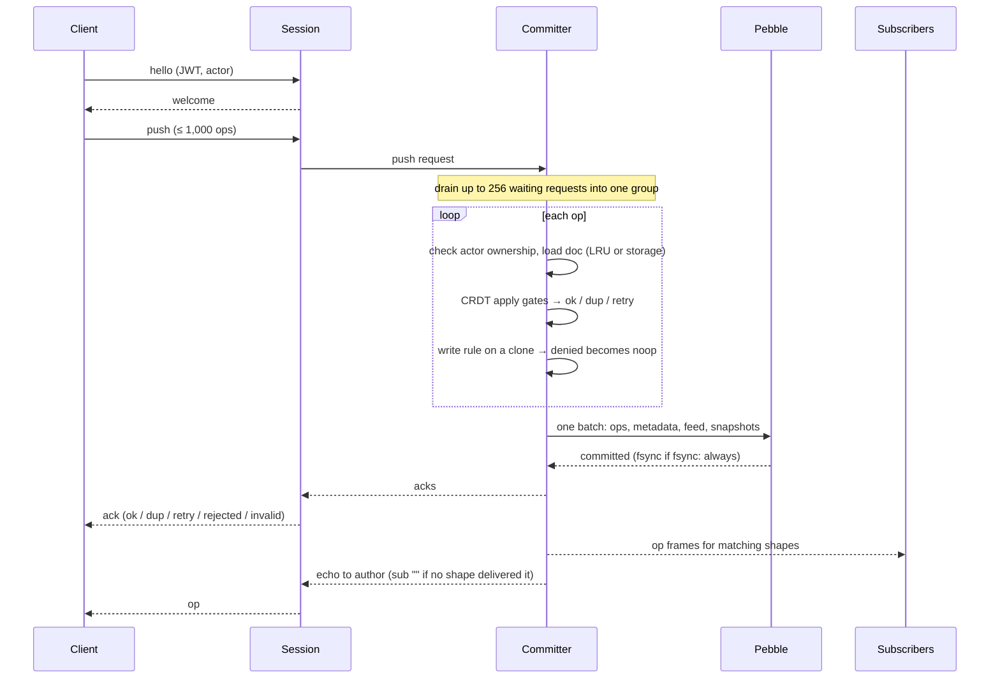
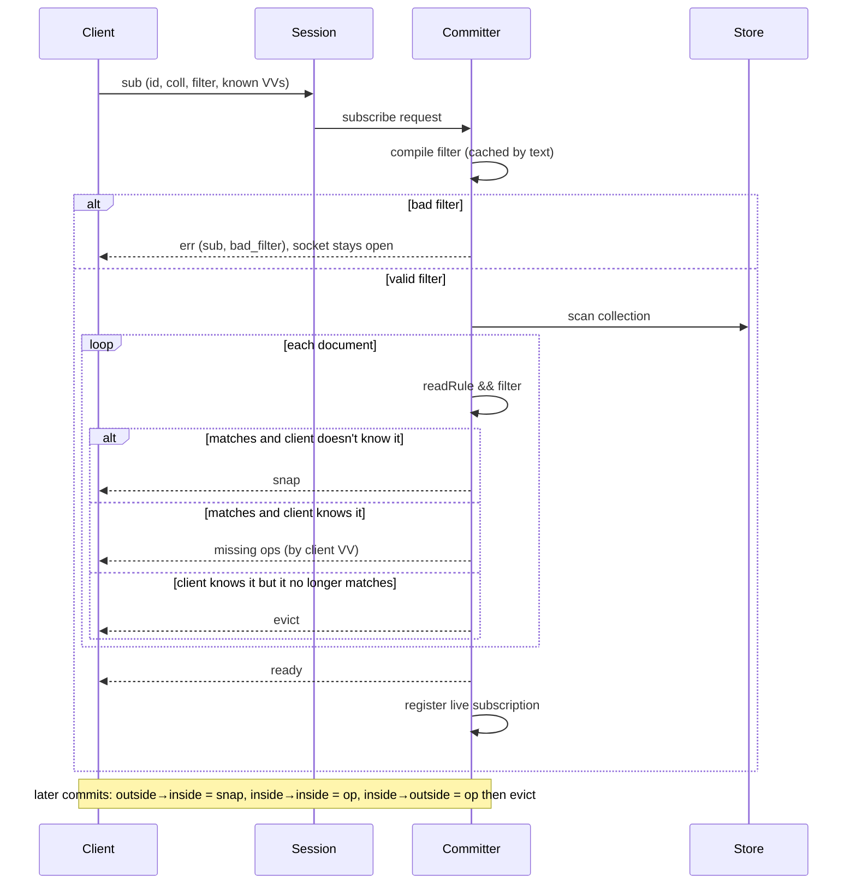
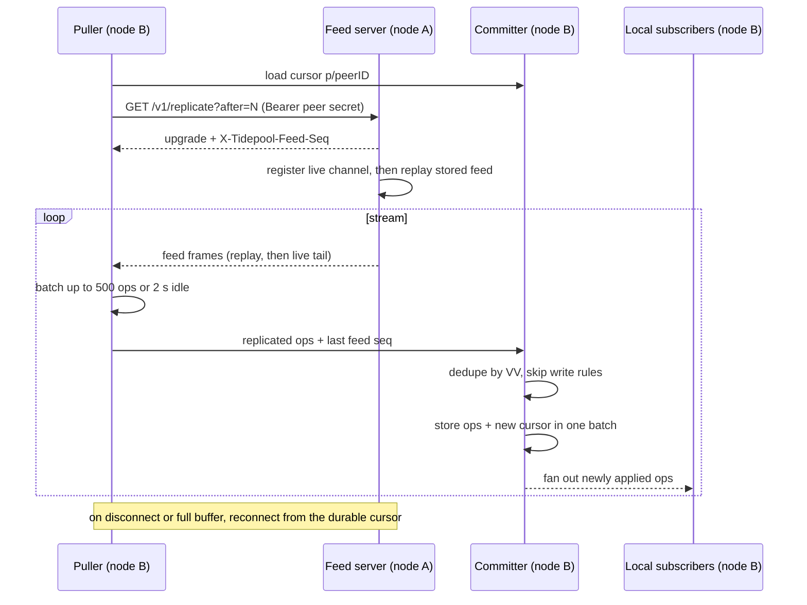

# Architecture

Tidepool synchronizes local CRDT replicas over WebSockets. Clients edit their
local view immediately; a node validates operations, commits them to Pebble,
and streams the accepted result back. Nodes pull each other's operation feeds
so clients can connect to different nodes without electing a leader.

## Local state and ownership

An operation has an `(actor, seq)` ID. Actor IDs identify installations rather
than people; sequence numbers are contiguous per actor **per document**. A
version vector (VV) records the last sequence applied from each actor. Lamport
clocks order competing register writes and sequence insertions; they are not
wall-clock timestamps.

A client keeps a confirmed document, pending local operations, and a derived
view made by applying pending operations over confirmed state. An accepted
operation's echo moves it into confirmed state. A rejected operation returns
as a noop, allowing the client to remove the optimistic edit and rebuild its
view. Go supports memory/file persistence; TypeScript supports memory/IndexedDB.
The kanban demo uses memory storage, so offline edits survive user switches but
not a page reload.

The committer goroutine owns document cache entries, subscriptions and shape
membership. Sessions have one socket reader and one writer; outbound frames
use bounded queues. Store implementations synchronize concurrent access, and
feed subscriber registration has its own mutex. Each node has a separate
Prometheus registry; its collectors are safe to read during commits.

## Push lifecycle

1. The session accepts `hello`, verifies an HS256 JWT, validates the actor,
   and sends `welcome`. JWT claims plus `uid` become the CEL auth map.
2. A `push` carries at most 1,000 operations by default. The session hands it
   to the committer, which drains up to 256 waiting requests into a group.
3. For each operation, validate identity and actor ownership (`a/<actor>`),
   load the document from the 10,000-entry LRU or storage, and run the
   [CRDT apply gates](CRDTS.md#apply-order). Missing sequences/dependencies
   produce `retry`; duplicates produce `dup`.
4. If a write rule exists, trial-apply to a deep clone. Evaluate CEL against
   `doc`, `newDoc`, `auth`, `isNew` and `op`. Here `isNew` means the field was
   absent, not that the whole document was absent. Evaluation errors deny.
   Denials or invalid values become stored noops with `rejected` results;
   invalid identities/ownership are not stored.
5. Stage the operation, per-document metadata, global feed entry and actor
   metadata in one batch. Snapshot every 100 new cached operations. Commit
   once for the group; `fsync: always` makes the write durable before reply.
6. After successful storage commit, enqueue acknowledgments and then fan-out
   frames. Commit failures invalidate touched cache entries and close affected
   sessions so clients reconnect and reconcile; they receive no successful ack.

Noop IDs advance the VV without changing fields or logical clocks. This keeps
later sequence numbers usable after authorization rejects an optimistic edit.
See [ADR 0004](adr/0004-noop-rejection.md).

## Subscribe and live shapes

A shape is a collection plus a CEL filter, intersected with its read rule.
The server compiles filters on subscribe and caches successful compilations by
text. A bad filter returns `err` with `sub` and leaves other subscriptions alive.

Reconciliation runs on the committer: scan the collection, load each document,
and evaluate `readRule && filter`. For matching documents, send a full `snap`
if unknown, otherwise missing operations selected by the client's VV. Evict
known documents outside the shape, enqueue `ready`, and register the live
subscription. A peered node retains a known document missing from its local
store because it may simply be waiting for replication.

For each committed operation, compare previous membership with current matching:

| Previous | Current | Frames |
|---|---|---|
| Outside | Inside | `snap` and record membership |
| Inside | Inside | `op` |
| Inside | Outside | `op`, then `evict`, and remove membership |
| Outside | Outside | None |

The author receives an operation echo even when no shape delivers it, using
`sub: ""`. Clients keep pending edits on eviction. Slow sessions whose queues
fill are disconnected and resume through ordinary reconciliation.

Subscribe costs O(documents in collection); live matching costs O(subscriptions
on that collection) per operation. Serialization avoids a separate scan/register
race, but large scans delay commits. See [ADR 0002](adr/0002-subscribe-in-committer.md)
and [ADR 0006](adr/0006-shape-scan.md).

## Peer replication lifecycle

1. One puller goroutine per peer loads `p/<peerID>` and connects to
   `/v1/replicate?after=N` with a Bearer peer secret.
2. The serving node registers a bounded live-feed channel before replaying
   stored history. It then tails live notifications, dropping entries already
   covered by replay. Feed positions are local to the sending node.
3. The puller reads batches of up to 500 operations; a two-second idle read
   ends the stream and flushes a partial batch before reconnecting. The peer
   cursor advances only after the receiving committer stores its batch.
4. The receiving committer deduplicates by VV, bypasses write-rule checks,
   assigns local document/feed sequences, and writes the peer cursor in the
   same batch. Newly applied operations fan out to local subscribers and feeds.
5. Disconnects or full feed buffers recover from the durable cursor. M12's
   `X-Tidepool-Feed-Seq` upgrade header supplies an observed remote high-water
   mark for lag metrics; it changes no feed frame JSON.

Replicated operations must be causally ordered and nodes must share schemas.
The current receiver logs/skips malformed or missing-dependency operations and
converts locally invalid operations to noops; configuration drift is not a
supported convergence mode. Authorization is decided against possibly stale
state at the origin. See [ADR 0003](adr/0003-multi-master.md).

## Storage and operating surfaces

Pebble stores document operations (`o/`), document metadata (`d/`), snapshots
(`s/`), the local feed (`f/`), actor ownership (`a/`), peer cursors (`p/`) and node
metadata (`m/`). A snapshot contains full CRDT state, including RGA tombstones;
it is not just the materialized JSON view. See [ADR 0005](adr/0005-pebble.md).

The public listener serves `/v1/sync`, `/healthz`, `/metrics`, and, when peers
are configured, `/v1/replicate`. The unauthenticated token endpoint exists only
with `dev_mode: true`. The optional `admin_listen` serves document inspection
and pprof, both guarded by `admin_token`. Inspect requests run through the
committer after storage commits so HTTP handlers do not read mutable cache
entries. [Benchmark results](../bench/RESULTS.md) document usage and limitations.

## Boundaries

Convergence does not provide serializable transactions, cross-document atomic
client edits, globally enforced uniqueness or immediate cluster-wide permission
revocation. Scalar registers/lists use JSON numbers; TypeScript sequences,
Lamports and counters must stay within its safe integer range. There is no
document deletion, tombstone GC, secondary shape index or encrypted storage
protocol. Development configs contain example secrets and are not deployment
credentials.
