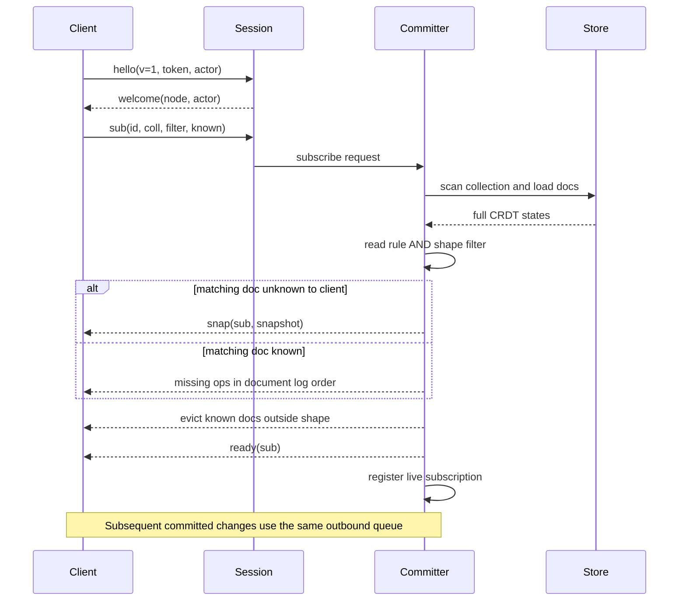
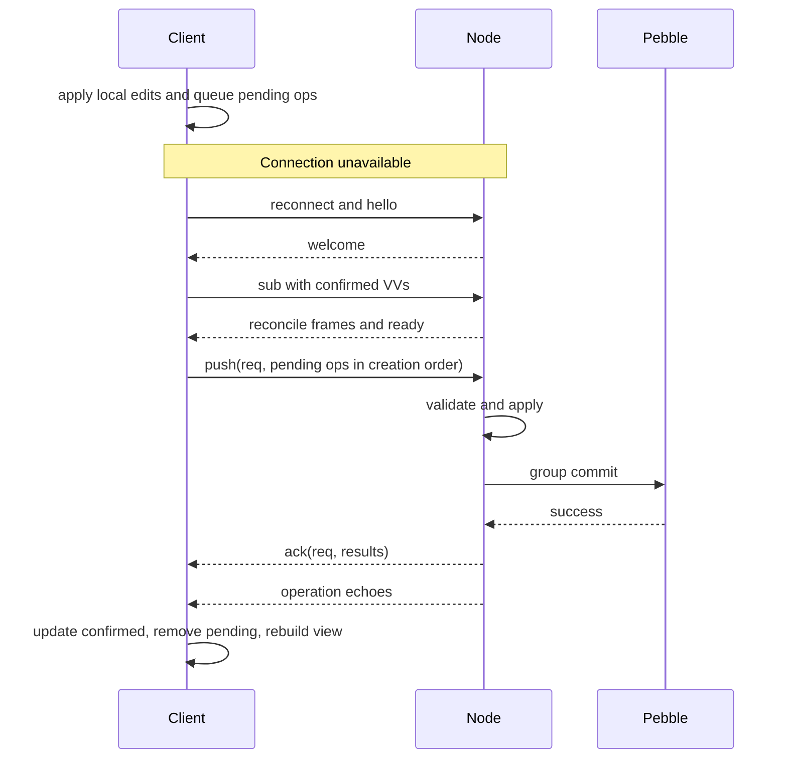
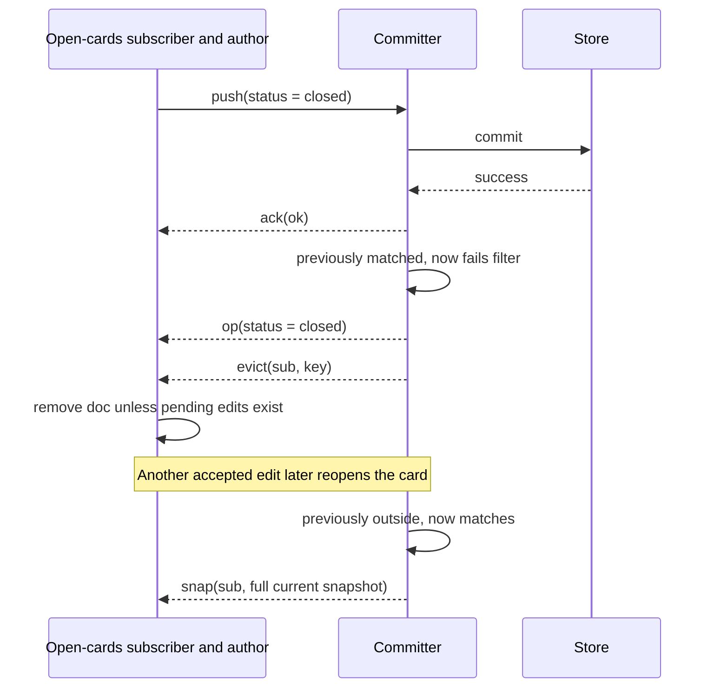

# Sync protocol v1

`GET /v1/sync` upgrades to WebSocket. Each text frame contains one JSON object
with a `t` discriminator; binary frames are rejected. The first frame must be
`hello` with protocol version 1, a JWT and a valid actor. `welcome` confirms
authentication. Reconnect and resubscribe after a closed socket.

## Frame reference

Client → server:

| `t` | Fields | Meaning |
|---|---|---|
| `hello` | `v` (=1), `token`, `actor` | Must be first frame. |
| `sub` | `id`, `coll`, `filter`, `known` (`map[docID]VV`) | Subscribe and reconcile; filter may be empty. |
| `unsub` | `id` | Stop a subscription. |
| `push` | `req` (int), `ops` ([]Op, max 1000 by default) | Submit local ops in creation order. |
| `ping` | — | Keepalive. |

Server → client:

| `t` | Fields | Meaning |
|---|---|---|
| `welcome` | `node`, `actor` | Handshake accepted. |
| `snap` | `sub`, `snapshot` | Full CRDT state for a doc entering the shape or unknown to the client. |
| `op` | `sub`, `op` | Apply to confirmed state; `sub: ""` is an author-only echo. |
| `evict` | `sub`, `key` | Doc left shape; drop locally unless pending ops exist. |
| `ready` | `sub` | Initial reconciliation finished. |
| `ack` | `req`, `results` (`[{id, status, reason}]`) | One result per pushed op in the same order; reason may be omitted. |
| `err` | `code`, `msg`, optional `sub` | Without sub: fatal and socket closes. With sub: that subscription failed. |
| `pong` | — | Response to ping. |

Request IDs correlate acknowledgments within a connection; subscription IDs
are client-chosen strings. `known` contains confirmed version vectors, not
materialized document values.

| Ack status | Stored? | Client action |
|---|---|---|
| `ok` | Yes | Wait for echo to confirm the operation. |
| `dup` | Already stored | Resolve duplicate; no new echo follows. |
| `retry` | No | Retain pending; resend after missing sequences/dependencies arrive. |
| `rejected` | As noop | Noop echo removes optimistic effect; surface the rejection. |
| `invalid` | No | Drop this and all later pending ops of the same doc; surface an error. |

Rule denial returns reason `rule_denied`; invalid type/value/Lamport can return
`invalid_op`. Bad identities or actor ownership are `invalid`, not stored
noops. Error reasons are diagnostics; use the status to drive recovery.

The connection guarantees are:

- **G1:** frames follow commit order on each connection.
- **G2:** every pushed operation ending `ok` or `rejected` is echoed exactly
  once to its author, through a subscription or `sub: ""`. Rejections echo noops.
- **G3:** after `ready`, matching documents equal the node's state, given no
  new writes. It is not a cluster-wide replication barrier.

A peered node retains a known document missing from its local store because
it may still be replicating. Clients retain pending edits on an eviction.

## Payloads

An Op contains `id: {actor, seq}`, `key: {coll, doc}`, `lamport`, `kind`,
and optional `field`, `value`, `delta`, `ref`, `observed`. The field must be a
valid name on applied operations, including noops. Sequences are contiguous
per actor per document. Registers use `set`; counters `inc`; sets `add`/`rem`;
lists and text `ins`/`del`. See [CRDTS.md](CRDTS.md) for checks and snapshots.

Each line below is a separate frame:

```json
{"t":"hello","v":1,"token":"<signed JWT>","actor":"0000000000000001"}
{"t":"sub","id":"open","coll":"cards","filter":"doc.status == \"open\"","known":{}}
{"t":"push","req":1,"ops":[{"id":{"actor":"0000000000000001","seq":1},"key":{"coll":"cards","doc":"c1"},"lamport":1,"field":"title","kind":"set","value":"Hello"}]}
```

These illustrate frame formats; writes must also satisfy configured rules.
Snapshots contain all CRDT metadata and tombstones, not just visible values.

## Connect and reconcile



Filters are CEL over `doc` and `auth`; read rules always also apply. Invalid
filter compilation returns `err` with `code: "bad_filter"` and `sub`, leaving
the socket and other subscriptions alive. Other fatal errors omit `sub`,
including authentication and malformed-frame errors. Evaluation errors in a
compiled filter or read rule count as non-matching.

## Offline push



Actual reconnects may send pending pushes while reconciliation is in flight;
the single socket and committer order the frames. Confirmed state plus pending
operations defines the optimistic view. Deduplicate with VVs, since replay
may confirm an operation before its resend acknowledgment arrives.

## Rejection rollback

```mermaid
sequenceDiagram
    participant C as Optimistic client
    participant W as Origin committer
    participant D as Pebble
    participant P as Other replicas
    C->>C: pending title = Bob's edit
    C->>W: push(op with actor/seq)
    W->>W: trial Apply on Clone and evaluate write rule
    W->>W: deny; Apply noop with same ID
    W->>D: commit noop and feed entry
    D-->>W: success
    W-->>C: ack(rejected, rule_denied)
    W-->>C: op(kind=noop)
    W-->>P: noop through subscriptions and peer feeds
    C->>C: advance confirmed VV and discard rejected pending edit
    C->>C: rebuild view from confirmed plus remaining pending
```

The noop consumes the sequence without changing fields or clocks. `isNew`
in a write rule means the target field was previously absent. Rules run at
the origin against its current local state; peer replay does not reevaluate
authorization.

## Move-out and move-in



An author outside all shapes still receives its echo. During move-in, the
author can receive both a snapshot and an echo; its VV prevents double
application. Use `unsub(id)` before switching shapes. The demo also filters
its retained local view by board, since retained documents do not necessarily
belong to the active subscription.

## Limits and other surfaces

Defaults are 1,000 operations per push, 1 MiB incoming frames, five seconds
for the first hello and 1,024 queued outbound frames per session. Push and
send-buffer limits are configurable. Full queues disconnect slow consumers;
reconnect/reconcile is recovery. Replies follow storage commit, but
`fsync: never` does not promise crash durability.

Use separate actors for concurrent installations. JWT subject becomes
`auth.uid`; other claims are also available to CEL. Actor ownership lives
under `a/<actor>`. Keep schemas consistent, and keep TypeScript numeric
sequences, clocks and counters within its safe integer range. There is no
document-delete or tombstone-GC protocol.

Peers connect to `GET /v1/replicate?after=N` with a Bearer peer secret. Frames
are `{"t":"feed","op":{"op":Op,"docSeq":N,"feedSeq":N}}`; positions belong
to the sending node. Receivers assign local positions and commit their peer
cursor atomically with the operations. The `X-Tidepool-Feed-Seq` upgrade
response header supplies an observed high-water mark for lag metrics.
Configure nonempty peer secrets; the current handler accepts requests when
none are set.

The public listener also serves `/healthz` and `/metrics`. Optional
`admin_listen` serves `/admin/docs/{coll}` (sorted IDs),
`/admin/docs/{coll}/{doc}` (`key`, `values`, `vv`, `snapshot`) and
`/debug/pprof/`, all requiring the admin Bearer token. `/dev/token?uid=` is an
unauthenticated helper enabled only by `dev_mode: true`.
See [architecture](ARCHITECTURE.md) and [operating examples](../bench/RESULTS.md#running-and-inspecting-a-node).
